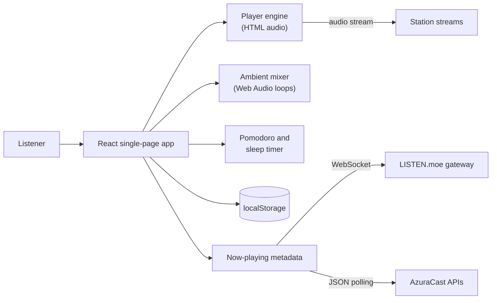

# rradio

> A small, private web radio with live stations, looping ambient recordings, a pomodoro timer and your own stations. It runs entirely in the browser.

<p>
  
  
  
  
  
</p>

## Tech Stack

| Area | Technology |
| --- | --- |
| UI | React 19, TypeScript |
| Build tooling | Vite 8 |
| Styling | Tailwind CSS 4 |
| Station audio | HTML `<audio>` element |
| Ambient sound | Web Audio API playing looping CC0 recordings from `public/ambient/` |
| Now-playing data | WebSocket (LISTEN.moe) and JSON polling (AzuraCast) |
| Persistence | `localStorage` in the visitor's browser |
| Installable app | Web app manifest and a small service worker |

## Overview

rradio is a single-page radio player in the spirit of lofi radio sites: pick a station, press play, and layer ambient sound over it. A pomodoro timer and a sleep timer sit alongside the player.

There is no backend and no account system. Favourites, settings and custom stations are stored in the browser's `localStorage`, and nothing is sent to a server of this project.

## Features

- **Stations**: LISTEN.moe J-pop and K-pop, six Lofi Cafe lofi stations (Chilling, Studying, Working, Sleeping, Gaming, Japanese Lofi), FluxFM Chillhop and Code Radio, grouped by genre with search and favourites.
- **Now playing**: live title and artist for LISTEN.moe over its WebSocket, and for Lofi Cafe and Code Radio by polling their AzuraCast API. FluxFM shows the station name only.
- **Player**: play/pause, previous/next station, volume and mute, Media Session integration for media keys, and automatic reconnect with backoff. LISTEN.moe falls back to its MP3 mount where Ogg Vorbis is not supported.
- **Ambient layers**: rain, vinyl, fire, ocean, tape, woods, river and storm, looping recordings played through the Web Audio API and fetched the first time a layer is switched on. Each layer has its own volume, plus an overall volume and a master play/pause.
- **Pomodoro**: 25 minute focus, 5 minute break and 15 minute long break by default, with a chime, the countdown in the tab title, and a choice to keep, lower or pause the music during breaks.
- **Sleep timer**: 15, 30, 45, 60 or 90 minutes, with a fade-out.
- **Your own stations**: add a direct stream URL, or an `.m3u`, `.m3u8` or `.pls` playlist that is parsed in the browser. Edit, delete and favourite them, and export or import them as JSON.
- **Preferences**: light, dark or system theme, and a data-saver mode that uses a lower bitrate where a station offers one and skips cover art.
- **Keyboard shortcuts**: `Space` play/pause, `M` mute, `N` next station, `P` previous station.

## Architecture



Music plays through a plain `<audio>` element, so third-party streams do not need CORS headers. The ambient mixer is separate: each layer is a decoded looping recording that passes through per-layer and master gain nodes. Station definitions live in one file, `src/config/stations.ts`, and user-added stations are merged with them at runtime.

## Getting Started

### Prerequisites

- Node.js `^20.19.0` or `>=22.12.0` (required by Vite 8)
- npm (the repository has a `package-lock.json`)

### Installation

```bash
git clone https://github.com/Nyxiie/rradio.git
cd rradio
npm install
```

The repository is private, so cloning needs access to the `Nyxiie` account.

### Configuration

None. There are no environment variables and no API keys.

### Run locally

```bash
npm run dev
```

Vite serves the app at <http://localhost:5173> by default.

| Script | What it does |
| --- | --- |
| `npm run dev` | Start the Vite dev server |
| `npm run build` | Type-check with `tsc -b`, then build to `dist/` |
| `npm run preview` | Serve the production build locally |
| `npm run icons` | Regenerate the PNG app icons from `scripts/gen-icons.mjs` |

## Project Structure

```text
src/
  App.tsx              Page layout, theme, keyboard shortcuts
  config/
    stations.ts        Built-in station registry
    ambient.ts         Ambient layer definitions
  components/          Station list, player bar, mixer, timers, settings, add-station form
  lib/
    player/            Audio engine, player state, Media Session
    ambient/           Web Audio context, mixer (loads and loops the recordings)
    metadata/          LISTEN.moe WebSocket client and AzuraCast polling
    playlist.ts        .m3u / .m3u8 / .pls parser
    customStations.ts  User station storage, import and export
    pomodoro.ts, sleepTimer.ts, settings.ts, storage.ts, store.ts
public/                Manifest, icons, service worker, ambient/ (loops and CREDITS.md)
scripts/gen-icons.mjs  Icon generator
```

## Usage

1. Pick a station from the list. Use the search box or genre chips to filter, and the star to favourite it.
2. Switch on one or more ambient layers and set their volumes, or use the play button to resume your last mix.
3. Start the pomodoro or set a sleep timer if you want one.
4. To add a station, press **Add**, then enter a stream URL or a playlist URL. If a playlist host blocks cross-origin requests, paste the playlist contents instead.

Some limits worth knowing:

- Plain `http://` stream URLs are rejected on an `https://` page because browsers block mixed content.
- `.m3u8` (HLS) streams play only in browsers with native HLS support, mainly Safari.
- Browsers cannot read ICY metadata, so custom stations show the station name rather than the current track.
- Ambient layers start only after a click, because browsers require a user gesture to start audio. Volumes are remembered; on/off state is not.

## Testing

No automated tests are configured. `npm run build` runs the TypeScript type-check and produces a production build.

## Deployment

The build output is a static site in `dist/`, with no server code, so any static host works. The intended host is Vercel, and `vercel.json` sets the build output, caching and security headers (including a Content-Security-Policy). The app has not been deployed yet. If you change the inline theme script in `index.html`, recompute the script hash in the CSP.

The audio streams belong to their stations and have their own terms of use. Check them before making a public deployment.

## Credits

Station streams and now-playing data come from [LISTEN.moe](https://listen.moe), [Lofi Cafe](https://loficafe.net), [FluxFM](https://www.fluxfm.de) and [freeCodeCamp Code Radio](https://coderadio.freecodecamp.org).

Ambient loops are cut from CC0 (public domain) recordings by Joseph Sardin and Pierre Sibanarco on [BigSoundBank](https://bigsoundbank.com), and from "Tape Noise Groove" by Antoni Robert on the [Internet Archive](https://archive.org/details/hr092). Per-file details are in [`public/ambient/CREDITS.md`](public/ambient/CREDITS.md).
